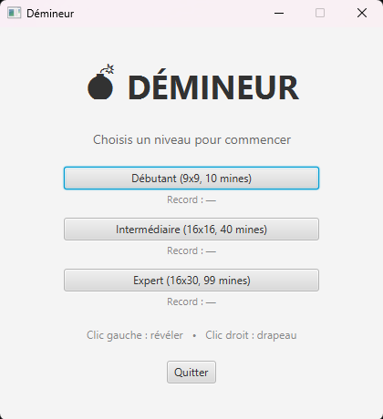
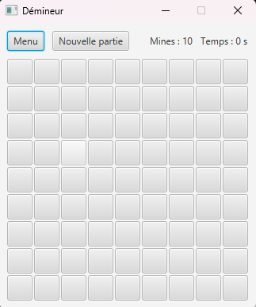
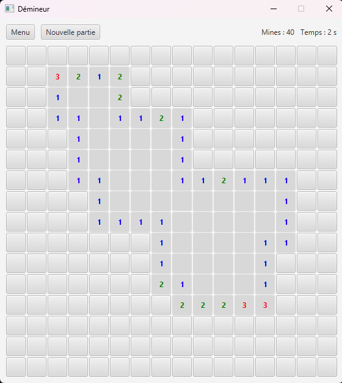
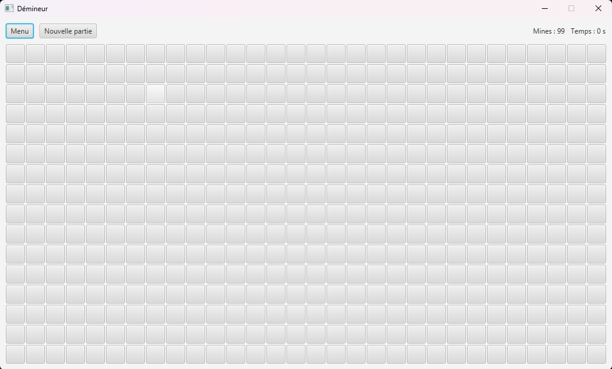
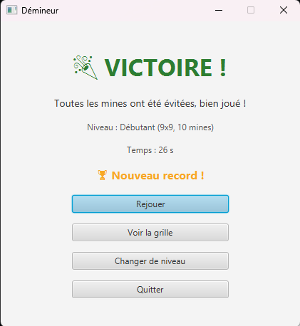
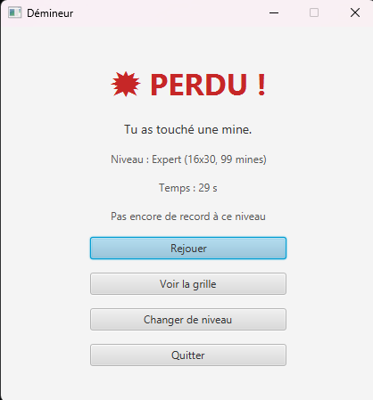

# 💣 Démineur JavaFX

Un jeu de **Démineur développé en Java avec JavaFX**, proposant une interface graphique interactive ainsi qu'une version jouable en console.

Le projet reprend les règles classiques du Démineur et propose trois niveaux de difficulté, un système de chronométrage et une sauvegarde des meilleurs temps.

## 📸 Aperçu du projet

### Menu principal



### Parties en cours

Le jeu propose trois niveaux de difficulté, chacun disposant d'une grille adaptée.

|                  Débutant                  |                    Intermédiaire                     |                 Expert                 |
|:------------------------------------------:|:----------------------------------------------------:|:--------------------------------------:|
|  |  |  |

### Fin de partie

L'application dispose d'un écran de fin permettant de visualiser le résultat de la partie.

|                  Victoire                   |                  Défaite                  |
|:-------------------------------------------:|:-----------------------------------------:|
|  |  |

## ✨ Fonctionnalités

- **Trois niveaux de difficulté** : débutant, intermédiaire et expert.
- **Premier clic sécurisé** : les mines sont placées après le premier clic, en protégeant la case sélectionnée et ses voisines.
- **Propagation automatique** : révélation des zones vides et des cases adjacentes.
- **Système de drapeaux** : possibilité de signaler les emplacements suspects.
- **Chronomètre et compteur** : suivi du temps de jeu et du nombre de mines restantes.
- **Gestion des parties** : écran d'accueil, sélection de la difficulté et écran de fin de partie.
- **Sauvegarde des records** : conservation des meilleurs temps pour chaque niveau, même après fermeture du jeu.
- **Version console** : possibilité de jouer directement depuis un terminal à l'aide de commandes clavier.

## 🎮 Niveaux de difficulté

| Niveau        | Dimensions de la grille | Nombre de mines |
|:--------------|:-----------------------:|:---------------:|
| Débutant      |          9 × 9          |       10        |
| Intermédiaire |         16 × 16         |       40        |
| Expert        |         16 × 30         |       99        |

## 🕹️ Commandes

| Action            | Interface graphique |  Version console  |
|:------------------|:-------------------:|:-----------------:|
| Révéler une case  |     Clic gauche     | `r ligne colonne` |
| Poser un drapeau  |     Clic droit      | `f ligne colonne` |
| Quitter la partie |   Bouton « Menu »   |        `q`        |

## 🛠️ Technologies utilisées

- **Java 17** : développement de la logique du jeu et programmation orientée objet.
- **JavaFX** : création de l'interface graphique et gestion des interactions utilisateur.
- **Maven** : gestion des dépendances et automatisation de la compilation.
- **Git / GitHub** : gestion du versionnement et hébergement du code source.

## ⚙️ Installation et lancement

### Prérequis

- JDK 17 ou supérieur.
- Maven (ou utilisation du Maven Wrapper fourni avec le projet).

### Récupération du projet

```bash
git clone https://github.com/Manof692/Demineur-JavaFX.git
cd Demineur-JavaFX
```

### Lancement

Sous Windows :

```bash
mvnw.cmd javafx:run
```

Sous Linux ou macOS :

```bash
chmod +x mvnw
./mvnw javafx:run
```

Le projet peut également être lancé depuis un IDE compatible avec Maven et JavaFX.

## 🏗️ Architecture du projet

Le projet suit une organisation séparant la logique métier des différentes interfaces utilisateur.

```text
src/
└── main/
    ├── java/
    │   └── fr/AMerlin692/Demineur/
    │       ├── Case.java
    │       ├── Plateau.java
    │       ├── Niveau.java
    │       ├── MeilleursTemps.java
    │       ├── DemineurApp.java
    │       ├── HelloController.java
    │       └── Launcher.java
    └── resources/

doc/
├── EcranDefaite.png
├── EcranVictoire.png
├── MenuPrincipal.png
├── PartieDebutant.png
├── PartieExpert.png
└── PartieIntermediaire.png
```

### Principales responsabilités

| Classe            | Responsabilité                                                              |
|:------------------|:----------------------------------------------------------------------------|
| `Case`            | Gestion de l'état d'une case : mine, révélation, drapeau et mines voisines. |
| `Plateau`         | Gestion de la grille et application des règles du jeu.                      |
| `Niveau`          | Définition des niveaux de difficulté et de leurs paramètres.                |
| `MeilleursTemps`  | Lecture et sauvegarde des records.                                          |
| `DemineurApp`     | Gestion de l'application et de l'interface JavaFX.                          |
| `Launcher`        | Point d'entrée de l'application.                                            |

## 💡 Choix techniques

### Séparation de la logique métier et de l'affichage

Les classes `Plateau` et `Case` sont indépendantes des interfaces graphiques et de la console. Les différentes interfaces peuvent ainsi exploiter une même logique métier, ce qui facilite la maintenance et l'évolution du projet.

### Placement différé des mines

Le placement des mines est effectué après le premier clic du joueur. La case sélectionnée ainsi que ses huit voisines sont protégées, garantissant un début de partie sans risque immédiat.

### Propagation des zones vides

Lorsqu'une case ne possède aucune mine dans son voisinage, ses cases adjacentes sont automatiquement révélées. Ce mécanisme repose sur une propagation récursive.

### Gestion des niveaux avec une énumération

L'énumération `Niveau` centralise les paramètres des différents niveaux de difficulté, notamment les dimensions de la grille et le nombre de mines. Cela permet d'éviter de disperser ces valeurs dans le code.

### Sauvegarde persistante des records

Les meilleurs temps sont enregistrés avec `java.util.Properties`, dans le fichier `meilleurs_temps.properties`, situé dans le dossier `.demineur` du répertoire personnel de l'utilisateur.

La suppression de ce fichier réinitialise les records.

## 👨‍💻 Auteur

**Alan Merlin**

Projet personnel réalisé dans le cadre de mon apprentissage du développement informatique, avec pour objectif de mettre en pratique la programmation orientée objet en Java et la création d'interfaces graphiques avec JavaFX.

[Voir le dépôt GitHub](https://github.com/Manof692/Demineur-JavaFX)